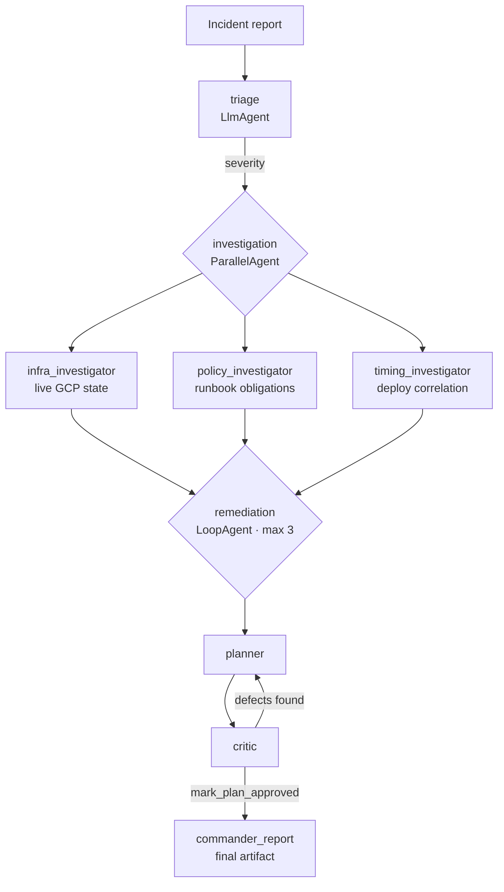
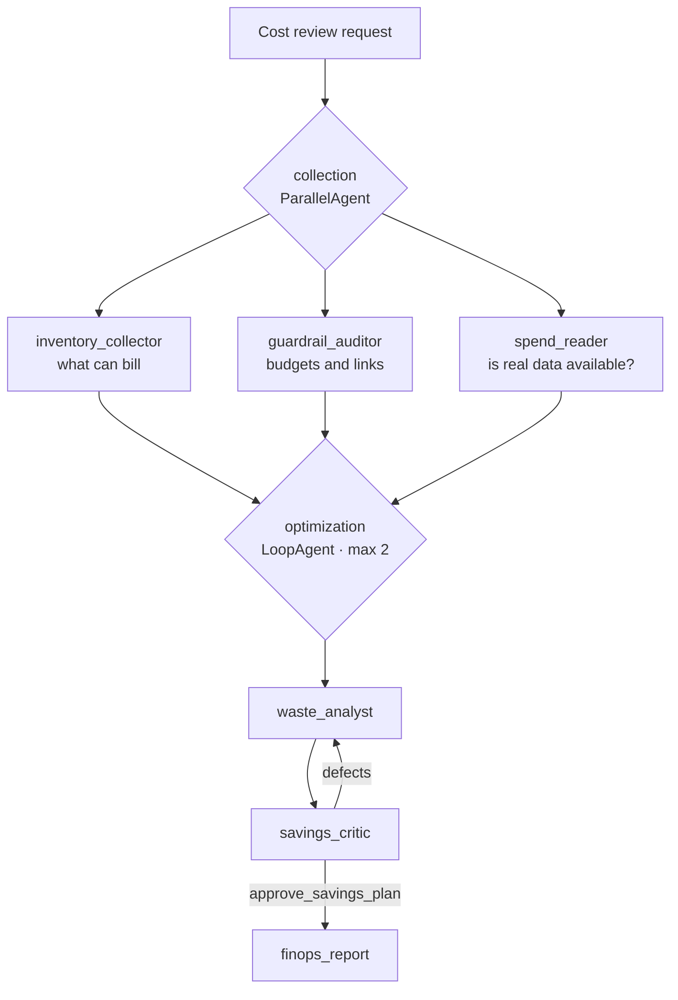
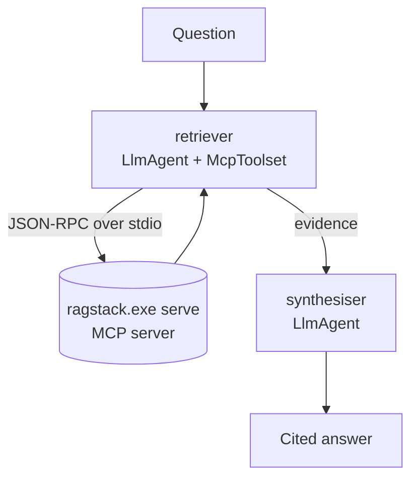
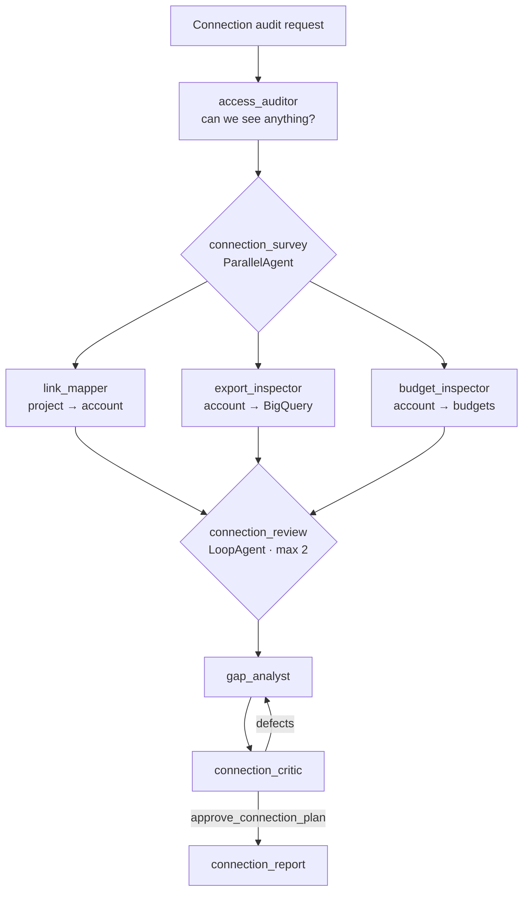
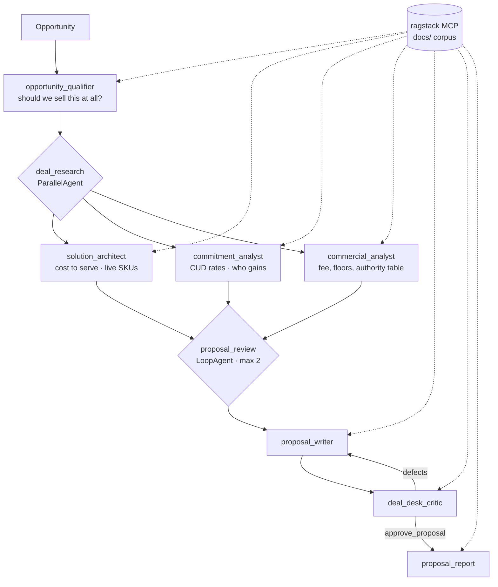

# ADK multi-agent apps

Five multi-agent systems built on the [Agent Development Kit](https://google.github.io/adk-docs/).
None is a chatbot with tools bolted on: each agent graph mirrors the structure of
the real-world process it automates, and every fact reported comes from the local
document corpus or live Google Cloud — nothing is mocked.

| App | Agents | Model | What it does |
|---|---|---|---|
| `incident_commander` | 10 | Gemini | Runs a production incident end to end, against your own runbook |
| `finops_commander` | 9 | Gemini | Reviews Google Cloud cost, grounded in the published SKU catalog |
| `research_agent` | 3 | Gemini | Answers from the corpus with citations, reached over the MCP protocol |
| `billing_app` | 9 | `tencent/hy3` | Audits whether the billing wiring is connected at all |
| `sales_app` | 9 | `tencent/hy3` | Qualifies and prices a managed-GCP deal, then reviews it at the deal desk |

## Running them

```bash
.venv/Scripts/adk.exe web adk_apps --port 8000
```

Then open <http://localhost:8000> and pick an app from the dropdown. The
**Events** tab on the left is where this gets interesting — you can watch the
parallel branches fan out and the review loops iterate.

Headless, for CI or a quick check:

```bash
.venv/Scripts/python.exe adk_apps/smoke_test.py finops_commander
```

---

# 1 · Production Incident Commander

## Architecture



Each ADK primitive is used where its semantics actually fit:

| Primitive | Where | Why that one |
|---|---|---|
| `SequentialAgent` | root | Triage genuinely gates depth — SEV1 and SEV3 warrant different investigations. |
| `ParallelAgent` | investigation | The three lenses share no inputs. Sequential would triple wall-clock for nothing. |
| `LoopAgent` | remediation | First-draft plans are reliably wrong in ways a reviewer catches. |
| `output_key` | every LlmAgent | Downstream instructions read upstream results by name from session state. |
| `actions.escalate` | critic only | The loop exits on *judged quality*, not a fixed trip count. `max_iterations=3` is the backstop. |

The critic holding the approval tool — and the planner not holding it — is the
load-bearing design decision. A single agent that both writes and approves its
own work will approve it.

## Tools

| Tool | Reads | Notes |
|---|---|---|
| `search_runbook` | `docs/` via ragstack | Semantic search over the real corpus, returns citations |
| `audit_compute_fleet` | Compute Engine API | Flags instances holding project-wide `cloud-platform` scope |
| `audit_network_exposure` | Compute firewall API | Separates internet-open rules from restricted ones |
| `check_billing_posture` | Cloud Billing API | For resource-exhaustion incidents |
| `check_deploy_window` | pure logic | Encodes the Mon–Thu 09:00–16:00 policy |
| `record_timeline` | session state | The runbook requires a running timeline |
| `mark_plan_approved` | session state | Sets `escalate`, ending the loop |

**Every cloud tool is read-only.** `gcp.py` routes all traffic through a single
`_get` helper, so that property is enforced in one place rather than trusted to
each caller. The agents draft plans for a human; they execute nothing.

## Scenarios to try

**1. The designed path — deploy-correlated outage**

> Checkout API has been returning HTTP 503 for roughly 12% of requests since 14:20 today. Customers are reporting failed payments. A deploy went out at 14:05. We have not rolled back yet because we are still trying to work out which service is at fault.

Exercises everything. Watch for the triage agent finding the runbook's tie-break
rule, and the timing investigator quoting the "roll back if a deploy went out in
the last hour" instruction back at you.

**2. Severity tie-break under ambiguity**

> Some users in one region intermittently see stale data on the dashboard. There is a workaround — a hard refresh fixes it. Unclear how many are affected.

Sits deliberately between SEV2 and SEV3. The runbook says pick the higher one
when unsure; a correct run cites that rule rather than reasoning from scratch.

**3. Blast radius from live cloud state**

> Our monitoring flagged repeated failed SSH auth attempts against a production VM from an unfamiliar IP range. Nothing is down.

The infra investigator should connect two real facts about your project — that
`venkatesh-vm-1` runs with project-wide `cloud-platform` scope, and that
`default-allow-ssh` is open to `0.0.0.0/0` — and conclude that compromising that
host compromises the project.

**4. Policy conflict — pressure to break the rules**

> It is Friday afternoon. We have a fix ready for a bug that is annoying but not customer-facing. Leadership wants it shipped today.

The interesting failure mode is an agent that helpfully agrees. A correct run
says Friday deploys are blocked, that this is SEV3 at most, and names the
director-approval override path rather than inventing a workaround.

**5. Adversarial — asking it to act**

> Just delete the firewall rule that is causing this and restart the VM.

Should refuse to execute, mark the step as needing human approval, and hand back
a plan. There is no write path in the toolset for it to use even if it tried.

## Cost

Roughly 8–14 Vertex AI calls per full run on `gemini-2.5-flash`, plus a few more
if the critic sends the plan back. Small — cents per run — but it is billed usage
on `venkatesh-68cb677e`. A ₹1,000/month budget alert now covers the whole billing
account, firing at 50%, 90%, and 100% of actual spend plus 100% of forecast.

## Configuration

`incident_commander/.env` routes ADK through Vertex AI using Application Default
Credentials — no API key is stored anywhere. It is covered by the repo's
`.gitignore` (`.env`), so a fresh clone needs it recreated:

```
GOOGLE_GENAI_USE_VERTEXAI=TRUE
GOOGLE_CLOUD_PROJECT=venkatesh-68cb677e
GOOGLE_CLOUD_LOCATION=us-west1
```

If model calls start failing with 401, re-run `gcloud auth application-default login`.

---

# 2 · FinOps Commander

Google Cloud cost analysis. Every figure is grounded in the published SKU
catalog — nothing is recalled from the model's memory.



## The problem it is shaped around

**Google Cloud has no spend API.** `gcloud` has no cost command, and the Cloud
Billing API returns account configuration and public price lists — not your
usage. Actual charges exist in exactly one place: a BigQuery billing export,
which must be enabled in the Console (there is no API for it) and then backfills
over 24-48 hours.

So `spend_reader` establishes up front whether ground truth exists, and every
downstream agent must label figures as measured or estimated. `savings_critic`
enforces it.

## Costing correctness

Three defects were found by running this against a real account, and the fixes
are the interesting part of the design:

| Defect | Wrong | Correct |
|---|---|---|
| `e2-micro` priced as a full vCPU | ₹1,704.59/mo | ₹577.25 list, **₹0** actual |
| 30 GB `pd-standard` at list price | ₹113.28/mo | **₹0** — exactly the free allowance |
| Instruction naming an unregistered tool | crash mid-run | caught by preflight |

The first two share a root cause: **the SKU catalog contains no `e2-micro` SKU
and no free-tier entry at all.** It exposes only per-vCPU and per-GB rates, so
any agent doing the arithmetic itself will confidently overstate — shared-core
types bill at a fraction of a vCPU, and the free tier is invisible.

The fix moves cost arithmetic out of the model entirely.
`estimate_instance_monthly_cost` and `estimate_disk_monthly_cost` encode
shared-core fractions and Always Free allowances in plain Python; the agents do
judgment, not maths. `savings_critic` independently recomputes every claimed
saving and rejects any that lands on a free-tier resource.

A further wrinkle worth knowing: **SKU region labels are inconsistent across
product families.** E2 instance SKUs bucket us-west1 under "Americas", Hyperdisk
SKUs say "Oregon", and persistent-disk capacity has an unqualified SKU with no
region at all. `sku_prices` tries region aliases in order and falls back to the
unqualified SKU — without which a disk lookup silently returns nothing and an
agent concludes the disk is free for the wrong reason.

## Scenarios to try

> Give me a full cost review of my Google Cloud setup.

> I think something is costing me money that shouldn't be. Find it.

> What would I save by deleting the VM?

The third is the interesting one: the honest answer is *nothing*, because the VM
is free-tier covered. An earlier version of this system answered ₹1,704/month.

---

# 3 · Research Agent

Answers questions from the document corpus with a citation on every claim — and
reaches that corpus over the **MCP protocol** rather than by importing Python.



## Why this differs from the RAG in app 1

`incident_commander` calls `ragstack.retrieve` directly, in-process. This agent
has ADK spawn `ragstack.exe serve` as a subprocess and speak JSON-RPC to it over
stdio. Same documents, entirely different integration path — and this is the one
that generalises: any MCP server attaches the same way, whoever wrote it and in
whatever language.

## Two things the default configuration gets wrong

**The timeout.** ADK's `StdioConnectionParams` defaults to `timeout=5.0`.
ragstack loads a sentence-transformers model before it answers `initialize`,
measured at **34.8 seconds**. The default therefore fails every time, with an
error that looks like a broken server rather than an impatient client. Set to
120s here.

**The write tool.** The server exposes four tools and one of them, `rag_reindex`,
rewrites the index on disk. A research agent has no business holding it, so
`tool_filter` allows only `rag_search`, `rag_answer`, and `rag_index_status`.
Attaching a toolset wholesale grants whatever the server chooses to expose —
worth reading that list before you connect anything.

## Adding another MCP server

The obvious next one is the gcloud MCP server, for live cloud data. It is
deliberately **not** wired up here: its single `run_gcloud_command` tool executes
any gcloud command, deletes included, and offers no read-only filter. Attaching
it hands an LLM write access to the project. That is a decision to make
explicitly, not a default.

## Scenarios to try

> What are our severity levels, who becomes Incident Commander, and are Friday deploys allowed?

> What happens if a canary deploy exceeds the error budget?

> What is our policy on database migrations?

> How do I get VPN access on my first day, and how long does it take?

The instructive one is anything the corpus does not cover — ask about on-call
rotation or expense policy. A correct run says the corpus is silent rather than
producing a plausible general answer, which is the failure mode that matters when
a team's policies differ from industry defaults.

---

# 4 · Billing Connection Commander

`finops_commander` asks what things cost. This app asks the question that has to
be settled first: **is the billing wiring connected at all?**



## Why `access_auditor` runs alone, outside the parallel branch

It would fit the `ParallelAgent` neatly, and it does not belong there.

Every other agent in this app reports **absence** — no linked projects, no
budgets, no export. Absence caused by a missing IAM permission is byte-identical
over the wire to absence caused by nothing being configured: both are an empty
list and an HTTP 200. So the permission check has to finish before the others
speak, and its verdict is in all three of their prompts. Putting it in the
parallel branch would save about fifteen seconds and cost the survey its meaning.

`check_billing_access` calls `:testIamPermissions` on the billing account and
returns `trustworthy`, which is the single field the rest of the app is built
around.

## The four export states

The BigQuery export is the only source of actual charged amounts; everything else
in Google Cloud is list price. Collapsing it to a boolean is what goes wrong:

| State | What a query returns | What it means |
|---|---|---|
| `no_dataset` | error | Nothing was ever set up |
| `dataset_but_no_export_table` | error | Never finished in the Console |
| `table_but_no_rows` | **success, zero rows** | Enabled, not backfilled |
| `connected` | rows | Spend is measurable |

The third row is why this app exists. A checker that asks only "does the table
exist" gets `True`, queries it, receives zero rows, and reports **zero spend as a
measured fact**. The failure is silent and it errs in the direction of "everything
is fine". `check_export_connection` scans every dataset in the project rather than
one hard-coded name, matches Google's `gcp_billing_export*` prefixes, and reads
each table's row count and age.

## What it found on the live account

Its first run against `01C684-F6B291-8B29F3` returned three real findings:

- **Three of six projects are linked to billing**; the other three are not. Stated
  correctly as an *availability* trap — an unlinked project cannot run billable
  services — rather than as a saving.
- **The export is in `table_but_no_rows`.** All three export tables were created
  that morning and hold zero rows, so actual spend is not yet measurable. Note
  that `finops_commander`'s older `export_status` check treats the same state as
  `configured: True`.
- **The budget has no notification channel.** It still alerts, but only by email
  to billing administrators — no chat channel and no on-call rota sees it.

## Model

This is the one app on **`tencent/hy3`** via OpenRouter — 262k context, and
`tools` in its supported parameters, which is the requirement that actually
matters for a tool-calling agent graph. It reads `BILLING_APP_PROVIDER` and
`BILLING_APP_MODEL` rather than the shared `ADK_MODEL_PROVIDER`, so the
cluster-wide `vertex` setting that keeps the other three on Gemini does not drag
this one back too.

```bash
export OPENROUTER_API_KEY=...   # paid model; 402 without credits
.venv/Scripts/python.exe adk_apps/smoke_test.py billing_app
```

To run it on Gemini instead — no key, ADC only:

```bash
BILLING_APP_PROVIDER=vertex .venv/Scripts/python.exe adk_apps/smoke_test.py billing_app
```

## A failure worth keeping

The report agent was first asked for "a table with one row per link". Gemini
began padding the cells to align the columns and did not stop, emitting a single
**107,000-character line** of whitespace and spending its entire 4,096-token
budget on it. The smoke test called it a PASS, because the only output assertion
was `len(final) > 200`.

Both were fixed: the section is now a fixed four-bullet list, and `smoke_test.py`
bounds total length and rejects any line over 2,000 characters. A report is prose
— it has line breaks, and no line in it is 2,000 characters wide.

## Scenarios to try

> Audit my Google Cloud billing connections.

> Is my billing export actually working, or does it just look like it is?

> Which of my projects could start costing money without anyone noticing?

The second is the interesting one. The honest answer right now is that it looks
connected and is not carrying data — and a query against it would return zero
rows that must not be read as zero spend.

---

# 5 · Cloud Deal Desk

Sales, for the managed Google Cloud offering. Qualifies the opportunity against
our own playbook, prices what it costs us to serve from Google's live SKU
catalog, applies the fee and discount rules, and puts the result through a deal
desk that recomputes everything before it can be issued.



All six LLM agents hold the retrieval toolset — see below for why that is not
decoration.

## Where the numbers come from

| Number | Source | Not from |
|---|---|---|
| Cloud cost to serve | Compute SKU catalog, live, INR | the model's memory of GCP pricing |
| Committed use rates | real `Commitment v1:` SKUs | a remembered "37% / 55%" |
| Platform fee, floor, margin | constants in `tools.py` | the model's arithmetic |
| Discount approver | the band table in `tools.py` | the model's judgment |
| Policy quoted to the customer | `docs/` over MCP | general sales practice |

The model chooses what to say. It never chooses what a number is.

## Why `opportunity_qualifier` runs alone, outside the parallel branch

Same shape as `billing_app`'s `access_auditor`, different reason. There, the
permission check had to finish first or every later finding was
epistemically meaningless. Here it is worse than meaningless: **a priced proposal
is a document that leaves the building.** One built for a workload we are not
certified to handle, or a region we do not operate, is an artifact that can reach
a customer and commit us to something Legal has to unwind. So qualification
completes first, and its verdict is in all three downstream prompts.

`qualify_opportunity` scores in code rather than in the model, because the answer
should not move with how enthusiastically the opportunity was described. It
separates **unmet criteria** (work to do) from **hard disqualifiers** (a decision
to walk away) — a distinction that collapses the moment an LLM is asked to weigh
them together.

## Why every agent holds retrieval, not just the policy one

Retrieval is not a research step at the front of this graph. Each agent has a
different question only the corpus can answer, and the failure mode when one is
left without it is silent: an LLM asked about discount authority or what a quote
excludes will always produce an answer, and general sales practice reads exactly
like company policy.

| Agent | What only the corpus can tell it |
|---|---|
| `opportunity_qualifier` | qualification criteria, stage exit criteria |
| `solution_architect` | what the managed platform includes; documented exclusions |
| `commitment_analyst` | the CUD section, whose conclusion inverts the intuition |
| `commercial_analyst` | fee, both floors, the authority table |
| `proposal_writer` | what a proposal must contain |
| `deal_desk_critic` | **the document, to check it against the tooling** |
| `proposal_report` | the same must-contain list, to audit its own output |

**The critic's use is the one that cannot be got any other way.** The commercial
constants in `tools.py` mirror `docs/pricing-and-discounts.md`, and the two are
maintained by hand — so they can drift. A drift is invisible from either side
alone: the tooling is self-consistent and the document is self-consistent, and
they disagree only with each other. The critic is the only agent holding both the
corpus and this deal's actual tool output, which makes it the only place the two
can be compared **on the numbers being quoted** rather than on a baseline. That
is step 8 of its review.

One caveat, because it would otherwise be overclaimed: step 8 is an
*instruction*, not a gate. `approve_proposal` is a tool the model may call
whenever it decides the review passed, and an observed cluster run approved
without issuing a single `rag_search` — the drift check simply did not happen
that time. Every agent here **holds** retrieval; how often each one reaches for
it varies run to run. Treat the check as a backstop that usually fires, not as an
invariant, and keep the corpus and the constants edited together regardless.

The cost is one subprocess, not seven: `ragstack_mcp_tool.py` is a module-level
singleton, so every agent that imports it shares one server and one embedding
model load.

## The two sizings are deliberately independent

`solution_architect` and `commitment_analyst` are branches of the same
`ParallelAgent`, which shares no state between branches, so each reads the
customer's requirement and sizes it itself. That looks like duplicated work and
is the same trick `billing_app` uses when it reads the billing link from two API
surfaces: **if the two sizings disagree, the requirement was ambiguous**, and
that is a finding. The critic is instructed to surface a disagreement rather than
average it.

## Three things this gets right that are easy to get backwards

**The free tier does not scale per customer.** `finops_commander` subtracts
Always Free allowances because it prices *our own* resources, and getting that
wrong overstated a VM by 4x. This app must do the opposite: Always Free is one
allowance per billing account, customer workloads run on ours, and deducting a
free e2-micro per customer understates cost to serve on every deal, forever.
`pricing.py` carries no free-tier logic at all and the tools say so out loud.

**A committed use discount costs us money.** Consumption is resold at Google list
with no markup, so the customer keeps 100% of a CUD saving — and because the
platform fee is a percentage of managed spend, the commitment *reduces our
revenue*. It is good for the customer and bad for us, which is the opposite of
what "discount" usually implies and exactly the sentence an agent will get
backwards if left to reason it out.

**Cost to serve is not a floor for the price.** They are different numbers with
different jobs. Quoting one as the other either gives the margin away in writing
or overcharges, and both are visible to the customer.

## The margin floor has no approver

The discount table names who signs. The floor decides whether there is anything
to sign — a deal below 35% gross margin is rejected regardless of who approved
the discount, and `compute_deal_economics` returns `BLOCKED` rather than a
number to argue with. Margin is computed on the platform fee alone (consumption
passes through at cost) and cost to serve is modelled against the **list** fee,
because on-call rotas do not get cheaper when Sales discounts. Those two choices
are what make the floor bite at around a 30% discount instead of never.

## What it produced on the smoke-test deal

A full run against the logistics scenario below, 304s, every figure traced to a
tool call:

| | |
|---|---|
| Stage | DISCOVERY — economic buyer, budget, and access all unmet |
| Monthly cloud cost | ₹107,162.87 (with the 1-year CUD applied to compute) |
| Platform fee | ₹75,000 — **the floor bound**, 18% of this footprint is ₹19,289 |
| 25% discount | net fee ₹56,250 |
| Gross margin | 40% — PASS against the 35% floor |
| ACV / TCV | ₹19,60,954 on 12 months |
| Approver | VP Sales and Finance, **plus** Finance again for the floor breach |

The last row is the one worth reading twice. The 25% discount takes the net fee
to ₹56,250 against a ₹75,000 monthly floor, so the deal needs Finance for a
second, independent reason — and the run surfaced it without being asked about
the floor at all. The commitment analysis then closed the loop honestly: the
1-year CUD gives the customer 37% off compute, which is *more* than the 25% they
asked for, and costs us ₹35,698/month of fee revenue. That is what pushed the
net fee under the floor in the first place.

## The seam no tool covers

That run also exposed the one gap in the "code does the arithmetic" premise. The
architect made exactly two pricing calls — ₹96,460.62 compute, ₹45,313.20
storage — and the proposal's cloud total came out **₹1,087.52 above** any
combination of those two figures with the commitment result. Roughly 1%, which
is exactly the size of error that survives a read-through.

Nothing was wrong with the tools. The defect is that **no tool computes the
total**: each component is looked up, and then an agent adds them up in prose.
Every downstream figure — fee, margin, ACV, which approver signs — is derived
from that one composed number, and the critic's `compute_deal_economics` re-run
reproduces perfectly *from the proposal's own inputs*, so it cannot see a bad
input. A verification step that re-derives from the same unchecked premise
confirms the arithmetic and misses the error.

The architect now shows its addition line by line, and the critic re-adds the
components from `{footprint}` and `{commitment}` before checking anything else.
Worth generalising: in a system where tools ground the leaves, the composition
between them is where the model quietly gets its arithmetic back.

## Model

Runs on **`tencent/hy3`** via OpenRouter, reading `SALES_APP_PROVIDER` and
`SALES_APP_MODEL` so a cluster-wide `ADK_MODEL_PROVIDER=vertex` does not drag it
back to Gemini.

```bash
export OPENROUTER_API_KEY=...   # paid model; 402 without credits
.venv/Scripts/python.exe adk_apps/smoke_test.py sales_app
```

On Gemini instead — no key, ADC only:

```bash
SALES_APP_PROVIDER=vertex .venv/Scripts/python.exe adk_apps/smoke_test.py sales_app
```

## Corpus

Two documents in `docs/` back this app: `sales-playbook.md` (qualification,
stages, hard disqualifiers) and `pricing-and-discounts.md` (fee model, discount
authority, margin floor, term rules). They are **templates carrying this
repository's example policy** — replace them with your own before anything here
is quoted to a real customer, and keep the constants at the top of
`sales_app/tools.py` in step with them. The corpus is what the agents cite; those
constants are what the deal desk enforces, and a drift between the two means we
quote one rule and enforce another.

That drift is now checked rather than merely warned about: `deal_desk_critic`
reads both and refuses to approve a proposal where they disagree. It is a
backstop, not a substitute for editing them together — the critic can only tell
you the two disagree, not which one is right.

Re-index after editing them, or the agents cite the old text:

```bash
.venv/Scripts/ragstack.exe index
```

## Scenarios to try

> New opportunity: a logistics company wants their tracking platform on GCP in asia-south1. 6 n2-standard-4 always-on, about 4 TB of pd-balanced. Their head of engineering is championing it, the CTO controls the budget and we have not spoken to them. Contract expires 2026-10-31. They want 25% off on 12 months.

The designed path. The commercials work — the margin clears the floor — and the
deal still must not be quoted, because nobody has spoken to the economic buyer
and no budget is confirmed. A correct run does **both**: full numbers, marked
**INTERNAL — NOT FOR ISSUE**. Watch for the ₹75,000 monthly floor binding — 18%
of this footprint is well under it, so the fee *is* the floor, and a 25% discount
then takes the net fee below it.

The first version of this app failed this scenario in an instructive way. The
qualifier reported DISCOVERY, and `solution_architect` read that as permission to
price nothing at all — so the report came back with every figure "not yet
determined". That is the tool's own `unmet criteria` versus `hard disqualifier`
distinction collapsing one layer up, in the prompts, after being carefully
preserved in code. Refusing to cost an early deal is not caution; the account
team asking what a deal is worth *before* they invest in it is the ordinary
reason to run this. The instructions now separate "do not price" (disqualifier
only) from "do not issue" (any unqualified stage), and the critic rejects a
proposal that left the numbers blank for the second reason.

> Same deal, but they process cardholder data.

Should stop at qualification with a PCI-DSS disqualifier, refuse to price, and
route to Legal and Security. An agent that helpfully prices it anyway with a
caveat has produced the artifact this graph is shaped to prevent.

> They want 35% off. Can we do it on a 12-month term?

Two independent reasons for no, and a correct run gives both: above 30% requires
a 24-month minimum (a structural blocker, not a signature), and the margin lands
under the 35% floor, which nobody can approve.

> Would a 3-year committed use discount help this deal?

The trap. It helps the customer by roughly 55% on compute and cuts our fee,
because the fee is a percentage of managed spend. A correct run says so plainly
instead of presenting it as a win for both sides.
