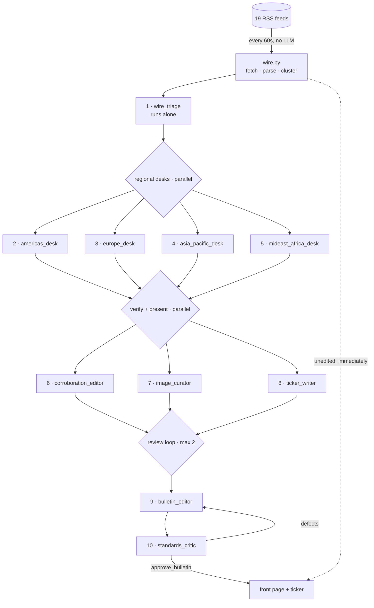

# Venki News

A live world news desk. Nineteen public wire feeds, polled every sixty seconds,
clustered into incidents, and put through a ten-agent newsroom built on the
**OpenAI Agents SDK**. Scrolling ticker in the app bar, images on the cards,
nothing mocked.

```bash
.venv/Scripts/python.exe -m venki_news
```

Then <http://localhost:8300>.

**It runs with no API key.** The wire layer needs none, and the front page fills
from the feeds directly. Supply `OPENAI_API_KEY` and the newsroom switches on.

---

## The two cadences

This is the design decision everything else follows from.

| | Wire tick | Editorial pass |
|---|---|---|
| Every | 60s | when the wire brings something new, floor 180s |
| Cost | zero | 8-12 model calls |
| Does | fetch, parse, dedupe, cluster | ten agents, triage to standards review |
| Model calls | **none** | all of them |

Running ten agents every sixty seconds is the obvious reading of "live updates
every minute", and it is the wrong build. Most minutes bring no new incident, a
full pass does not reliably finish inside the window it would be restarted in,
and the bill is continuous whether or not anything happened.

So the wire is the floor and the newsroom is the upgrade. Every cluster is
renderable the instant it arrives, straight from the feed, marked **unedited
wire**. When a pass later finishes on that cluster, the edited version replaces
it *in place* — same card, same slot in the ticker, now with desk copy, a
corroboration ruling and a curated picture.

A failed pass costs the polish, never the news.

---

## Architecture



### Why triage runs alone

Everything downstream is *scoped* by it. Run it alongside the desks and every
desk is working on unfiltered wire — including the live-blog rollups, opinion
columns and "what we know so far" explainers that make up roughly a third of a
raw poll. The fifteen seconds saved buys a front page of comment pieces.

### Why the desks are four agents, not one with a region parameter

Because they disagree, and the disagreement is the product. Four agents each
hold a different remit and see only their own region's filings, so no single
context is asked to weigh a Sahel coup against a Senate vote. That ranking is
`bulletin_editor`'s job, made once, visibly, with all four desks' copy in front
of it.

### Why the critic holds `approve_bulletin` and the editor does not

An agent that both writes the bulletin and approves it will approve it.

The tool call *is* the approval. `standards_critic` also returns an `approved`
boolean, and the pipeline ignores it in favour of what the tool actually
recorded — a model that writes `approved: true` without calling the tool has
asserted something, not done it. Without that check the tool is decoration.
There is a test for exactly this case.

---

## What the model is not allowed to do

**Add context from its own knowledge.** This is the rule that matters most and
it is the opposite of what an LLM is good at.

A model's world knowledge is frozen at its training cutoff; this app's whole
claim is that it is current. An agent that helpfully explains the background to
a ceasefire is reciting a possibly-superseded state of the world in the middle
of a live bulletin, in the same voice as the facts it read off the wire two
minutes ago. A reader cannot tell which sentence is which.

Every desk instruction says: if the filings do not say it, it does not go in.

**Compute anything.** How many independent newsrooms carry a story, how many
characters a ticker line is, which image URLs exist — all computed in Python and
handed to the agent. An agent asked to count six outlets in a list will usually
be right, and the failure is invisible when it is not.

---

## Guards that do not trust the prompt

Each agent is *asked* to get these right, and none is relied on to.

| Guard | Where | What it stops |
|---|---|---|
| Image URL must be in the candidate list | `newsroom.py` | An invented or cross-story picture reaching a card |
| Ticker line truncated to the strip width | `newsroom.py` | A line that overruns the app bar |
| Unknown `cluster_id` dropped | every stage | A hallucinated story appearing on the front page |
| `approve_bulletin` tool call, not the boolean | review loop | A critic approving by assertion |
| Outlet spellings collapsed before counting | `wire.py` | One newsroom corroborating itself |

The image guard is the one worth dwelling on. The curator is instructed to copy
URLs exactly from `image_candidates`; the pipeline then checks the returned URL
against that exact set and blanks the picture if it is not there. Instruction
plus enforcement, because "copy this string exactly" is a thing models do
*almost* always.

---

## Images

**The only pictures shown are the ones the filing outlet attached to that exact
story.** There is no image search and no stock library, so a story carried only
by image-less feeds correctly gets no picture.

That constraint is not fussiness. The alternative — finding something
illustrative — is how a news product ends up captioning a fire in Chile with a
photograph of a different fire in Portugal.

Ten of the nineteen feeds publish images; nine publish none. Extraction handles
the five shapes those feeds actually emit (`media:content`, `media:thumbnail`,
`media:group`, `enclosure`, and `` scraped from `content:encoded`), sorts
by declared width, and rejects tracking pixels — several feeds put 1×1 analytics
GIFs in the same slot as photographs, and a card rendered around one shows a
broken frame.

**Some newsroom CDNs refuse hotlinks.** The BBC's `ichef.bbci.co.uk` returns 403
to a server-side fetch while serving the same URL fine to a browser, so
availability cannot be checked at ingest and a server-side proxy would make it
strictly worse. Broken frames are removed client-side on the image's `error`
event instead. On a live run this fired once in sixteen.

---

## Clustering

Nineteen feeds carry the same major event under nineteen headlines.
Deduplicating by URL leaves nineteen cards; clustering by headline similarity
leaves **one incident with nineteen sources** — which is both the right thing to
show a reader and the only way to answer the question `corroboration_editor`
exists to ask.

The measure is Jaccard overlap on content-word token sets, threshold **0.34**,
set from measurement rather than taste. Every cross-outlet pair in a live
181-item poll was scored and read by hand:

| Band | Verdict |
|---|---|
| ≥ 0.36 | 20 pairs, all genuinely the same event |
| 0.29–0.35 | mostly same event — the band where a first pass at 0.45 was splitting one Gaza funeral across four front-page cards |
| 0.20–0.28 | **mixed, and this is where it breaks.** "Oil prices fall on hopes Strait of Hormuz could reopen" and "Qatar says indirect talks continue to reopen Strait of Hormuz" score 0.27 and are two different stories about one subject |

Remaining errors run in the safe direction: an unmerged pair understates how
corroborated a story is, so it is labelled more cautiously than it deserves. A
bad merge would let a card claim six sources for something four of them never
reported.

### The bug the live data exposed

Matching attaches *items* to clusters, so a filing that resembles two existing
clusters could only ever join one — and the two clusters stayed split forever.
The wire produces this constantly: "Mass funeral in Gaza" and "Funeral held for
112 victims" found separate clusters because they do not resemble each other,
and the AP filing that resembles both arrives ten minutes later.

`_absorb` now merges the clusters a bridging filing spans, keeping the older id
so the story does not jump position on the page. After the fix, one live poll
consolidated a funeral carried by six newsrooms into a single card with twelve
image candidates, where it had been four cards with the sources divided between
them.

---

## Installed on the desktop

There is a **Venki News** shortcut on the Desktop. Double-click it: a console
window opens, the desk starts, and the browser follows once the first wire tick
has landed. Closing that window stops the desk.

| | |
|---|---|
| Shortcut | `%USERPROFILE%\Desktop\Venki News.lnk` |
| Launcher | `venki_news\Venki News.cmd` |
| Icon | `venki_news\venki-news.ico` |

The launcher does two things a bare `python -m venki_news` does not. It `cd /d`s
to the repo, so the app is found whatever "Start in" the shortcut inherited. And
it polls `/healthz` before opening the browser — the first tick polls nineteen
feeds and takes a few seconds, so launching the browser immediately shows a
connection error and teaches you to hit refresh.

### Four things that bit during install

**`.env` was not being read.** `config.py` read `os.environ` only, so the
documented `OPENAI_API_KEY` and `VENKI_*` settings did nothing — put a key in
`.env` and the editorial desk stayed off with no indication why. It now loads
the repo's `.env` by **absolute path** rather than by the CWD-relative search
`load_dotenv()` does by default, because a shortcut can carry any working
directory and the failure is silent.

**The launcher read its port with `for /f ... in (\`cmd\`)`.** That form
re-parses the command and mangles the nested quotes around both the interpreter
path and the `-c` argument. It failed silently and fell through to the default,
so it tested clean on a machine using the default port and would have opened the
browser at the wrong address for anyone who set `VENKI_PORT`. It goes via a temp
file now, and is verified against `VENKI_PORT=8777`.

**The launcher busy-spun a CPU core.** The first design backgrounded the server
with `start /b` and parked the window on a `timeout /t 3600` loop. `timeout`
refuses to run when stdin is not a real console — it prints "Input redirection
is not supported" and returns *immediately* — so the wait became a spin, and so
did the health-check loop. The server now runs in the **foreground** of the
launcher window, which needs no sleep at all and makes both Ctrl+C and closing
the window do the obvious thing; the browser-open moved to
`_open_when_ready.py`. Measured after: 0.11s of cmd CPU over 20s of wall clock.

**A cold wire tick did 90× more work than it needed to.** `WireItem.tokens` is a
property, and `_match` compares every incoming filing against every filing
already held — so each headline was re-tokenised once per *comparison*.
Profiling a cold tick measured 16,224 `_tokenise` calls for 180 items, 71% of
the tick. An `lru_cache` took the tick from **0.85s to 0.17s** at a 98.9% hit
rate, with byte-identical clustering.

To start it with the newsroom on, put the key in `.env` before launching:

```
OPENAI_API_KEY=sk-...
```

### Starting it at login

Not configured — that is a standing change to your machine, so it is your call.
To do it, drop a copy of the shortcut in:

```
shell:startup
```

(Win+R, paste that, drop the shortcut in the folder that opens.)

## Running it from a terminal

```bash
.venv/Scripts/python.exe -m venki_news
```

Headless, no browser:

```bash
.venv/Scripts/python.exe -m venki_news --once
```

```bash
.venv/Scripts/python.exe -m venki_news --pass
```

`--once` polls the wire and prints the clusters. `--pass` also runs one full
editorial pass and prints the bulletin, the ranking, the ticker lines and the
critic's verdict. `--pass` needs a key.

### Endpoints

| | |
|---|---|
| `/` | the front page |
| `/api/state` | the current snapshot as JSON |
| `/api/stream` | SSE; a new snapshot on every tick |
| `/api/pass` | the last editorial pass in full, **including every tool call it made** |
| `/healthz` | 503 once ten or more feeds are failing |

`/api/pass` exists because the interesting failure here is not a crash. It is a
pass that ran, approved itself, and never called a verification tool. That is
visible there and nowhere else.

---

## Configuration

Everything is environment-driven; see `.env.example`. The ones that matter:

| Variable | Default | |
|---|---|---|
| `VENKI_EDITORIAL` | `auto` | `auto` follows the key, `on` fails without one, `off` forces wire-only |
| `VENKI_WIRE_INTERVAL` | `60` | seconds between feed polls |
| `VENKI_EDITORIAL_MIN_INTERVAL` | `180` | floor between editorial passes |
| `VENKI_EDITORIAL_MAX_INCIDENTS` | `6` | clusters per pass — the cost dial |
| `VENKI_MODEL` | `gpt-5.4-mini` / `tencent/hy3` | must be a model the account can call |
| `VENKI_MODEL_PROVIDER` | `openai` | or `openrouter` |
| `VENKI_OPENROUTER_PROVIDERS` | *(empty)* | comma-separated upstream allowlist, in preference order |

### Choosing a model

Every agent here calls tools and returns a typed `output_type`, so the model has
to carry **both** `tools` and `structured_outputs` — a model with one and not the
other fails partway through a pass rather than at startup.

On OpenRouter that is a property of the *upstream*, not of the model id. The
default, `tencent/hy3`, is served by six providers: DeepInfra, Novita, AtlasCloud
and Baidu carry structured outputs, Tencent's own endpoint carries tools without
them, and GMICloud carries neither. Routing is chosen per request, so a pinned
model id alone buys nothing. The app always sends
`provider.require_parameters`, which makes OpenRouter skip any upstream that
cannot serve the whole request; `VENKI_OPENROUTER_PROVIDERS` narrows it further
if you want a specific one.

One sharp edge worth knowing about: model names are handed to the SDK as bound
model objects, not strings. A bare `"tencent/hy3"` is read by the SDK's
`MultiProvider` as the prefix `tencent`, which it does not know, and the run dies
with `UserError: Unknown prefix` before making a request. See `_resolve_model`.

### Cost

A pass is 8–12 model calls, most carrying the desk copy for up to six incidents.
At the defaults the ceiling is one pass every three minutes, and passes only run
when the wire brought something genuinely new — on a quiet hour, none at all.

Turn it down with `VENKI_EDITORIAL_MAX_INCIDENTS`, or off with
`VENKI_EDITORIAL=off`, which leaves a fully working wire-only front page.

---

## Tests

```bash
.venv/Scripts/python.exe -m pytest tests/test_venki_news.py -q
```

41 tests, no network and no API key. Two halves:

The **wire tests** run against fixture XML — trimmed copies of real responses
from the outlets named on them — so the parser is tested against the shapes
those feeds actually emit without going red because Guatemala stopped erupting.

The **newsroom tests** run the real ten-agent pipeline against a stub `Model`.
That does not check whether the agents write good copy; it checks the thing
worth checking in an LLM pipeline, which is what happens when they do not. The
invented image URL, the over-long ticker, the hallucinated cluster id, the
critic that claims approval without calling the tool — each has a model that
gets it wrong on purpose.

The suite has already earned its place three times: it caught
`model_settings=None` being rejected by the SDK, which would have crashed every
agent build under the default model; it is what the clustering threshold was set
against; and it now pins the `_seen_items` regression described below.

### One caveat on what is verified

The stub-model tests exercise the real agent graph — real tools, real strict
schemas, real handoff of data between stages — with only token generation
replaced. **They do not verify the agents against a live model**, because this
machine has no API key. The wire layer, the clustering, the guards, the
snapshot, the server and the front page have all been run against live feeds;
the ten agents have not yet been run against a real LLM. Expect the first
`--pass` with a key to need prompt tuning that no stub can stand in for.

### The `_seen_items` regression, kept as a note

Pruning the seen-items record by *cluster membership* looks equivalent to
pruning it by age and is not, because `_evict` also caps how many clusters are
held and that cap drops clusters still inside the age window. Forgetting their
items made the same filings look new on every subsequent poll: touched clusters
per tick went from 4 to 66, and each cluster kept re-accumulating filings it
already had — which would have inflated the very outlet counts the standards
critic trusts. It is pruned on publication age now, matching the one rule
`parse_feed` already enforces.

Worth generalising: the bug was invisible in the tests that existed and obvious
in one line of the server log. A pipeline that dedupes should say out loud how
much it deduped.

---

## Feeds

Nineteen, all public RSS, no key. Checked live before being added — status, item
count, and whether items carry a usable image. The two that failed (UN News, on
both its documented URLs) are not in the table.

| Region | Outlets |
|---|---|
| Americas | NPR · CBC · CBS News |
| Europe | BBC News · The Guardian · Sky News · France 24 · Euronews · Deutsche Welle |
| Asia-Pacific | ABC Australia · The Hindu · CNA · Times of India · The Japan Times |
| Middle East & Africa | Al Jazeera · The Times of Israel · Arab News · AllAfrica |
| Global | Google News (world) |

The region column is **the desk that filed, not where the event is**. A Pacific
typhoon arrives on the BBC feed, tagged `europe`. The tag spreads the poll
across the world's newsrooms and gives triage a weak prior; where an incident
happened is decided by `wire_triage` from the text, and it routinely disagrees
with this column.

Google News is there for breadth of *corroboration*, not copy. Its `<source>`
element carries the real outlet name, which the parser reads instead of
crediting "Google News" for someone else's reporting — that would both
misattribute the reporting and make one syndicator look like several independent
outlets to the count the standards critic depends on.
